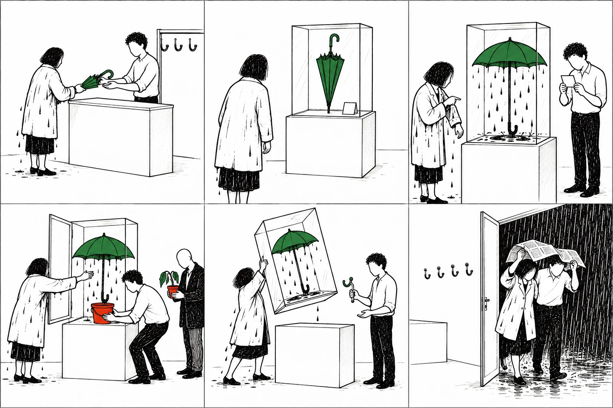
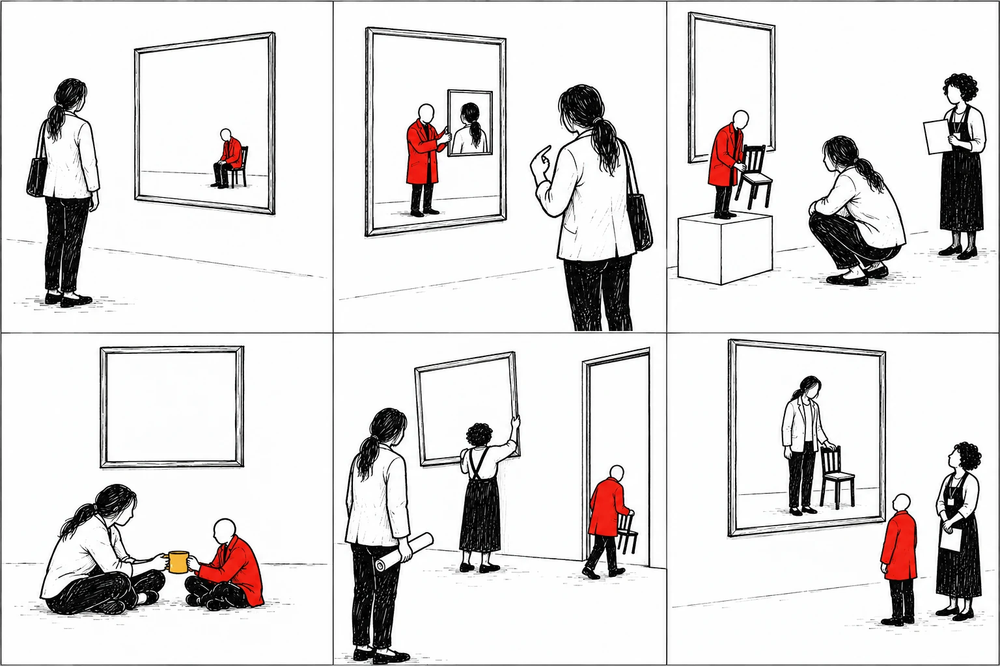
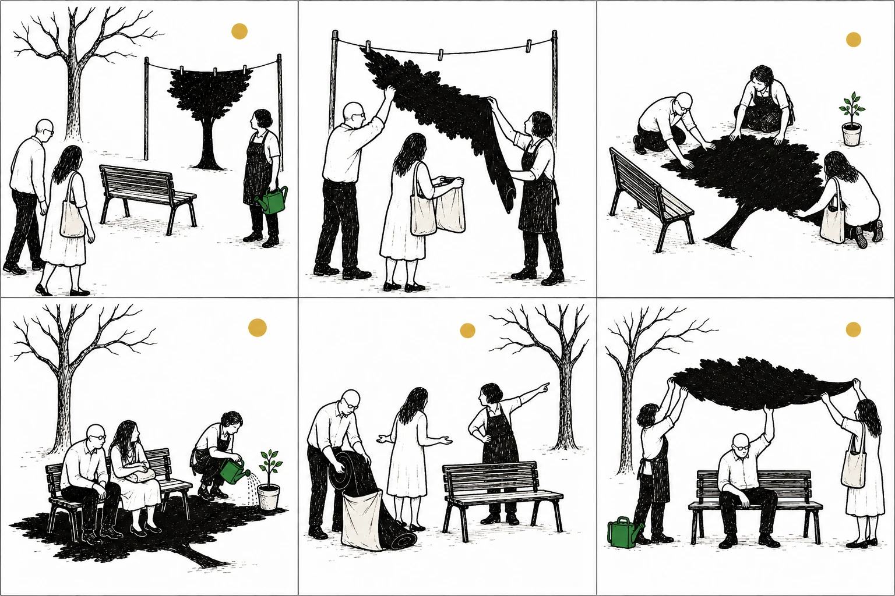
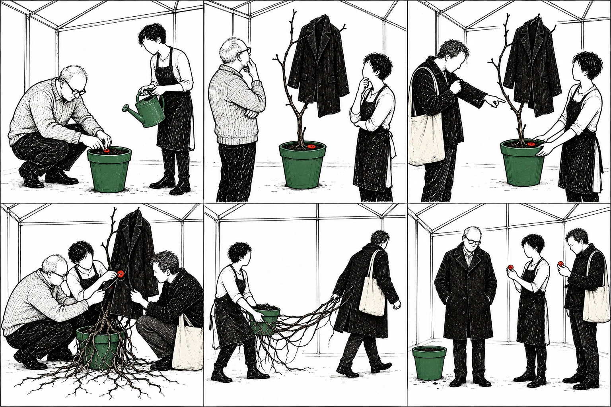
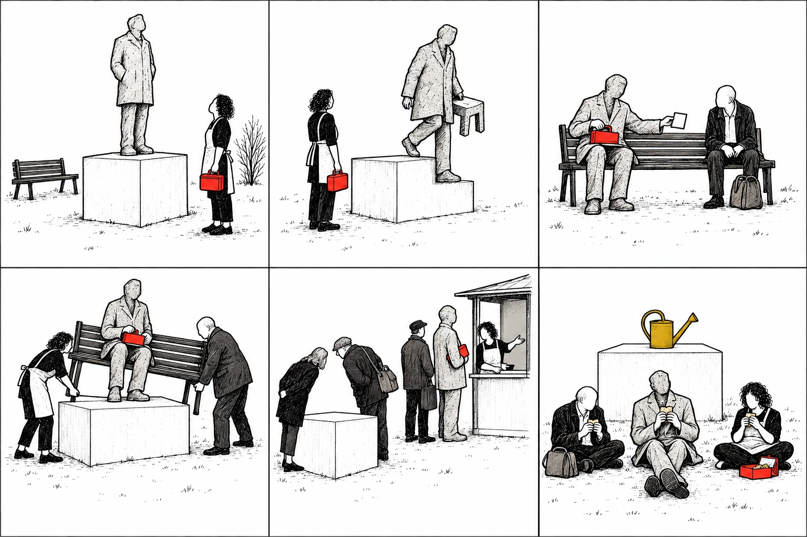
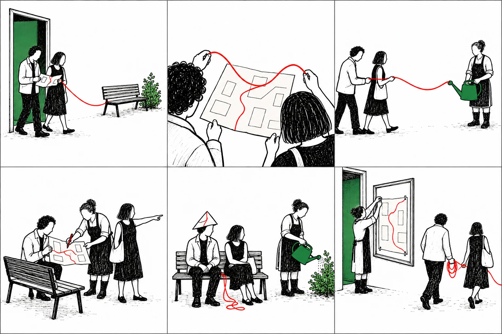

# Museus, galerias e jardins — seis pranchas, 36 imagens

Estudos adicionais pedidos pelo docente, em 29 outubro 2026. Desenho a tinta, branco, preto e cor pontual. Todas as situações e obras representadas são ficções autorais, sem identificar obras ou instituições reais. Não integram ainda os exercícios publicados nem a seleção consolidada de 140 cartas.

Cada prancha contém seis situações relacionadas. Os primeiros planos podem construir uma descoberta; os seguintes permitem testar consequências ou outras ordens. Esta é uma possibilidade de montagem, não uma solução obrigatória. As descrições literais e recortes estão em [CARTAS.json](CARTAS.json), IDs 31-01 a 36-06.

## 31 — O museu expõe o meu guarda-chuva

O objeto de que a visitante precisa passou a ser uma peça de museu. O que sucede quando utilidade, cuidado e exposição entram em conflito? Experimentar uma reclamação fictícia, a conversa com quem trabalha no museu e um desfecho que preserve uma dificuldade. O visitante com planta pode introduzir outra necessidade, não uma solução automaticamente superior.

## 32 — A figura do quadro pediu uma pausa

Uma figura pintada também observa e quer agir. Escrever a visita a partir de quem olha e depois de quem é olhado. O quadro vazio pode representar ausência, intervalo, trabalho recusado ou outra situação construída pelo texto. A troca final de posições não prova se houve acordo: é matéria de história.

## 33 — A sombra da árvore mudou de lugar

Duas pessoas querem descansar; a sombra não está junto da árvore. Quem a pode deslocar, guardar ou partilhar? Criar duas versões com necessidades diferentes. A solução que faz sentido para uma pessoa pode criar trabalho para outra. Não medir o valor do desfecho apenas pelo número de pessoas reunidas.

## 34 — Plantaram um botão

Um botão dá origem a um casaco e alguém pensa reconhecê-lo. A semelhança não prova de quem é. Construir a ligação com uma informação adicional assumidamente inventada. O casaco pode ser memória, roupa necessária, coisa que se quer vender ou algo que ninguém quer levar. As raízes tornam a escolha materialmente mais difícil.

## 35 — A estátua foi sentar-se

Uma estátua muda de função; um banco e um regador passam a ocupar lugares diferentes. Experimentar a crónica de uma pausa, um diálogo sobre a exposição e uma montagem que comece pelo pedestal vazio. O sentido depende do que o contexto torna relevante, não de o jogo atribuir um significado fixo a cada objeto.

## 36 — O passeio não cabia no mapa

Um percurso transforma-se num fio e chega ao trabalho de outra pessoa. Pode seguir-se a linha, pedir outra direção, mudar o mapa ou usá-lo para outra coisa. Escrever duas versões em que o mesmo encontro interrompe ou transforma a visita. O itinerário de uma pessoa não é necessariamente a prioridade de quem encontra pelo caminho.

## Aplicações propostas

**Três lugares, duas histórias:** 31-02, 33-03 e 35-06. Ligar primeiro por acontecimentos; depois experimentar uma analogia entre objeto útil, espaço e valor de exposição. Uma cor comum pode ajudar a criar continuidade, mas não prova que se trata do mesmo objeto.

**Quem olha para quem:** 32-02, 32-03 e 32-06. Mudar o ponto de vista e o género de texto. A segunda versão deve alterar conhecimento ou seleção de informação, não apenas nomes.

**Uma escolha, duas consequências:** escolher uma situação e dois possíveis desenvolvimentos numa prancha. Escrever a ação intermédia que torna cada passagem legível. Pedir a outro leitor o que conseguiu inferir antes de revelar a intenção.

**Jogo entre pranchas:** usar o regador de 33 como ligação ao regador exposto de 35 ou ao percurso de 36. Conservar uma versão e mudar uma carta. Identificar se a mudança criou causa, contraste ou apenas semelhança; se o efeito for fraco, tentar outra combinação.

## Produção e integração

As seis pranchas WebP mantêm 1536×1024, grelha 3×2 e recortes 512×512. Os PNG originais foram guardados fora do repositório. Os caminhos `file` em `CARTAS.json` são relativos à raiz `curadoria/baralho-improvavel/`; índices de linha/coluna começam em zero. Prompts em [PROMPTS-MUSEUS-E-JARDINS.md](../prompts/PROMPTS-MUSEUS-E-JARDINS.md).

O catálogo adicional reúne agora 60 estudos em dez pranchas (27–36). Não os acrescentar automaticamente como aprovados à curadoria anterior. Antes de jogo final, rever continuidade visual, detalhe visível em projeção e abertura real das ligações. As descrições do resultado prevalecem sobre o que o prompt pretendia produzir.
