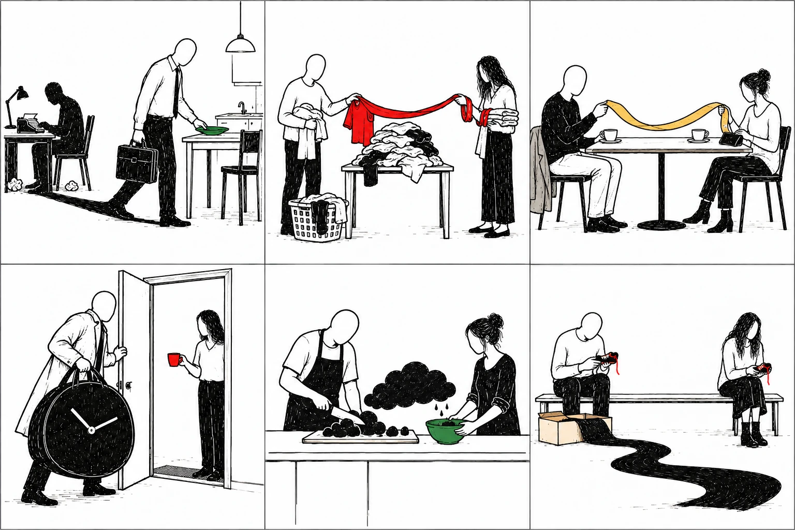
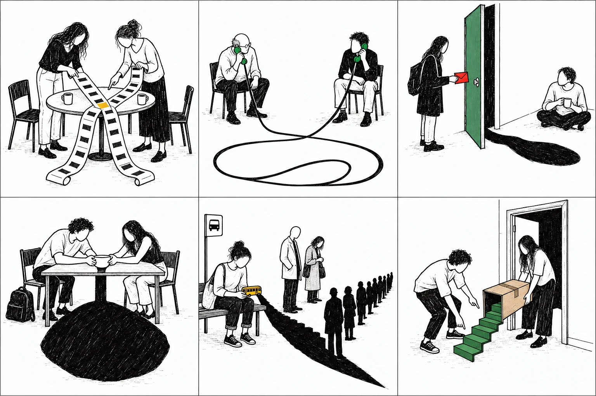
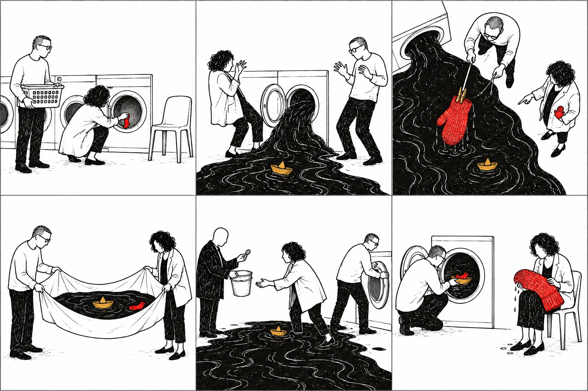
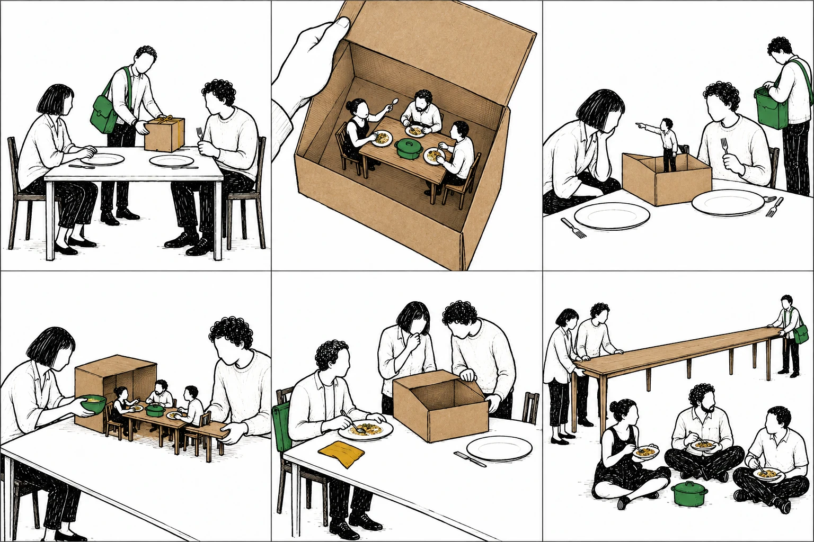

# Mais perto do quotidiano — 24 novos estudos

O docente pediu imagens mais interessantes e reconhecíveis no mesmo estilo. Estas duas pranchas acrescentam problemas de trabalho, tempo, amizade, casa e ajuda. São **propostas por validar**, sem mudar as 140 cartas da seleção anterior. As interpretações seguintes são sementes autorais, não respostas certas.

Uma segunda atualização acrescenta as pranchas 29–30: duas micro-histórias com descoberta, conflito e possibilidades de consequência, para desenvolver além da metáfora isolada. O catálogo adicional reúne agora quatro pranchas e 24 cartas.

## 27 — Cheguei, mas fiquei lá

Uma pessoa chega para jantar, mas a sombra continua no trabalho. Uma manga liga uma tarefa a outra pessoa. Um café entre amigos traz uma conta que se estende entre ambos. Um relógio dificulta a entrada em casa. Preparar comida envolve lidar com uma nuvem. Dois sapatos abrem uma distância.

**Motores de história:** quem consegue terminar o dia? O que cada pessoa considera uma divisão justa? O encontro tem o mesmo custo para ambas? O que se pode partilhar sem conseguir resolver? Não atribuir parentesco ou intenções como factos da imagem.

## 28 — Quase combinámos

Duas agendas encontram um intervalo pequeno. Uma chamada parece aumentar a distância. A sombra chega antes da visita. Uma taça vazia pesa. O transporte tem uma fila maior do que o veículo. Uma mudança revela um caminho que ninguém tinha planeado.

**Motores de história:** tentar marcar um encontro sem desistir de outras responsabilidades; querer falar mas não saber começar; pedir companhia sem pedir solução; descobrir um desvio durante uma tarefa banal. Conservar desacordo, limites e humor; não obrigar a reconciliação.

## Proposta de ensaio

Escolher **27-01, 28-01 e 07-05**. Escrever uma história em que a visita é consequência de um encontro que não aconteceu. Depois conservar as cartas e escrever uma carta literária em torno de «chegar» sem coincidir com estar presente. Identificar o pormenor que sustenta cada relação e o que o texto inventou.

Outra combinação: **27-02, 27-05 e 28-04**, uma jornada temática doméstica. Criar diálogo, conflito e proposta de partilha; reescrever a partir da outra posição. A segunda proposta é uma extensão do modo inicial, não cumpre a restrição de três universos distintos.

## Para o Claude

[CARTAS.json](CARTAS.json) fornece os 24 IDs, descrições e recortes (grelha 3×2, índices de zero). Os caminhos `file` desse JSON são relativos à raiz `curadoria/baralho-improvavel/`. Não acrescentar automaticamente estes cartões a `kept: true` no catálogo consolidado. Validar primeiro abertura, legibilidade e diferença em relação a motivos já existentes. Prompts em [PROMPTS-QUOTIDIANO.md](../prompts/PROMPTS-QUOTIDIANO.md) e [PROMPTS-MICRO-HISTORIAS.md](../prompts/PROMPTS-MICRO-HISTORIAS.md).

Os quatro WebP preservam 1536×1024 e usam compressão de distribuição; não houve alteração das cenas. Os originais PNG ficam guardados fora do repositório. Estes materiais não foram integrados em exercícios nem publicados no site.

## 29 — A lavandaria devolve o mar

Uma meia entra, um mar sai, e uma luva enorme parece familiar a alguém. O encontro do insólito altera uma tarefa banal. As personagens podem tentar conter a água, negociar a sua utilização ou enviar algo de volta. Cada escolha distribui tarefas e acesso de maneira diferente. Não afirmar que a luva é de uma personagem só pela semelhança: essa ligação é uma hipótese de história.

**Ensaio:** escolher dois dos primeiros planos para criar uma expectativa; acrescentar o terceiro apenas depois de registar essa expectativa. Testar dois dos planos inferiores como consequências alternativas. Escrever a conversa em que as personagens deixam de estar de acordo sobre o que fazer. O visitante com moeda pode ter razões para a proposta; não é um vilão automático.

## 30 — A encomenda trazia outro jantar

O pedido chega com outras pessoas dentro, ainda a jantar. Essas pessoas têm prioridades e tentam intervir; o destinatário e o estafeta não controlam tudo. As alternativas envolvem ligar as mesas, uma substituição inexplicada ou um problema novo de escala.

**Ensaio:** escrever primeiro a reclamação de quem recebeu a caixa; depois a resposta de quem vinha dentro. Que factos partilham? Em que discordam? Testar um plano de consequência que não seja o esperado e acrescentar uma ação que torne essa passagem legível. A incoerência de escala pode tornar-se regra da ficção, mas não se deve fingir uma continuidade que o leitor não consegue reconstruir.

Estas propostas são um modo de começar a escrever; manter a possibilidade de outras sequências e histórias. O primeiro protótipo deve testar se um corte altera realmente a expectativa, em vez de apenas validar a ordem prevista pelo autor.
